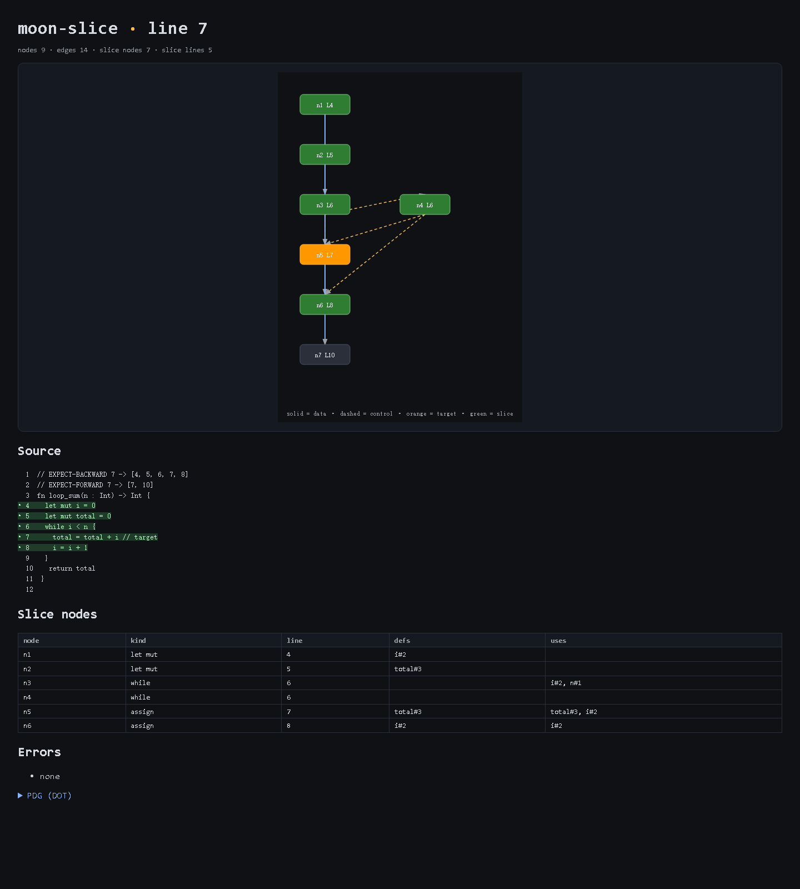
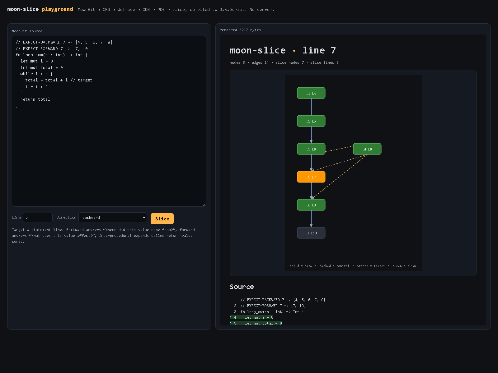

# moon-slice

[](https://github.com/cs6210501-lab/moon-slice/actions/workflows/ci.yml)
[](https://github.com/cs6210501-lab/moon-slice/actions/workflows/pages.yml)

A program-slicing workbench for MoonBit. Point it at a `.mbt` source file and a
target line; get back the **backward slice** (which statements may have produced
the value at that line) and the **forward slice** (which statements that value
may affect).

Slicing is the standard way to answer "what here matters to this line", and it is
the usual first step for debugging, impact analysis before a refactor, and
narrowing down a diff during review.



[Open the generated report](docs/report.html) (self-contained HTML; no toolchain needed).

[Open the browser playground](https://cs6210501-lab.github.io/moon-slice/) — edit the source, choose a line and direction, and render the report live. The same page is in `web/index.html`.

The HTML report renders the PDG as an inline SVG, highlights the slice in the
source, and stays self-contained (no network, no CDN).

## Status

All layers are implemented and covered by `moon test` (211 tests, including a
10-example end-to-end corpus and an independent precision oracle). The data
model is frozen; the CLI is usable.

| Layer | Package | State |
| --- | --- | --- |
| Data model | `src/core` | frozen — types only |
| Parser adapter | `src/parser_adapter` | implemented — MoonBit AST → `SNode` |
| CFG | `src/cfg` | implemented — sequence, branch, loop, jump edges |
| Def-use | `src/defuse` | implemented — reaching definitions |
| CDG | `src/cdg` | implemented — structured control dependence |
| PDG | `src/pdg` | implemented — data + control edges |
| Slicing | `src/slice` | implemented — backward/forward BFS |
| Query helpers | `src/query` | implemented — line → node, dead/unreachable, data-flow paths |
| Report | `src/report` | implemented — JSON, DOT, inline SVG, HTML |
| CLI | `cmd/main` | implemented — `slice`, `graph`, `callgraph`, `dead`, `path`, `html`, debug dumps |
| Browser playground | `src/web`, `web/` | implemented — JS build + single page |
| Example corpus | `examples/`, `testdata/` | 10 examples + expected JSON |

## Quickstart

Everything goes through the wrapper, which puts the MoonBit toolchain on `PATH`:

```bash
./dev.sh check      # type-check the whole module
./dev.sh test       # run the test suite
```

Run the CLI with `./dev.sh run cmd/main -- ...`:

```bash
./dev.sh run cmd/main -- version
# moon-slice 0.3.0
./dev.sh run cmd/main -- slice --file examples/04_while.mbt --line 7 --direction backward
# 4,5,6,7,8
./dev.sh run cmd/main -- slice --file examples/04_while.mbt --line 7 --direction forward
# 7,10
./dev.sh run cmd/main -- slice --file examples/04_while.mbt --line 7 --direction backward --json
# {"nodes":[0,1,2,3,4,5,6],"lines":[4,5,6,7,8],"errors":[]}
./dev.sh run cmd/main -- graph --file examples/04_while.mbt --format dot
./dev.sh run cmd/main -- callgraph --file bench/callgraph.mbt
# digraph callgraph { "twice" -> "inc"; "main_fn" -> "twice"; }
./dev.sh run cmd/main -- dead  --file examples/08_dead_assignment.mbt
# 4,5
./dev.sh run cmd/main -- path  --file examples/04_while.mbt --from i --to total
# n1 L4 -> n5 L7
./dev.sh run cmd/main -- html  --file examples/04_while.mbt --line 7 --out report.html
```

`bench/bench.mjs` measures the native release binary on generated inputs; see
`bench/README.md` for the command and the current numbers.

`path --from A --to B` is the taint-lite query: it finds the shortest directed
PDG path from a definition of `A` to a use of `B`. `dead` reports both
definitions with no reaching use and statements unreachable from a function
entry.

The CLI exits `0` on success and `2` on any usage error, unreadable input,
write failure, parse diagnostic or unknown node id; it never prints a result for
a run that failed. When one line holds several statements, it prints the
candidate node ids and `--node ID` selects one.

The same pipeline from MoonBit code:

```moonbit
let program = @parser_adapter.parse_source(source, "examples/04_while.mbt")
let cfg     = @cfg.build(program)
let defuse  = @defuse.analyze(program, cfg)
let cdg     = @cdg.build(program, cfg)
let pdg     = @pdg.build(defuse, cdg)
let node    = @query.target_node(program, 7).unwrap()
let result  = @slice.backward(pdg, node, program=program)
println(result.lines) // [4, 5, 6, 7, 8]
```

## Architecture

Five passes over one shared, immutable data model. Each stage consumes the
previous stage's output and nothing else, so each can be tested on a
hand-built input:

```text
.mbt source
    │
    ▼
parser adapter   moonbitlang/parser AST ──▶ @core.Program      (SNode tree, Loc, VarId)
    │
    ▼
CFG              @core.Program  ──▶ @core.Cfg                   (Int32×Int32 edges, entry, exit)
    │
    ▼
def-use          Program + Cfg  ──▶ @core.DefUse               (reaching definitions)
    │
    ▼
CDG              Program + Cfg  ──▶ @core.Cdg                   (controller → controlled)
    │
    ▼
PDG              DefUse + Cdg   ──▶ @core.Pdg                   (data + control edges)
    │
    ▼
slice            Pdg + target   ──▶ @core.SliceResult           (node ids, sorted lines)
    │
    ▼
report           Program + Result ──▶ JSON / DOT / HTML          (wave 2)
```

Design points worth knowing:

- **The IR is the contract.** `src/core/types.mbt` is frozen; every package
  agrees on `SNode`, `Cfg`, `DefUse`, `Cdg`, `Pdg`, `SliceResult`. This is what
  lets the passes be built and tested independently and in parallel.
- **Node ids are the unit; lines are the view.** A node carries a `Loc` and a
  `start_line`. `SliceResult` returns both `nodes` and `lines`; `lines` is the
  unique sorted projection used for display and for the example corpus.
- **Variables are `VarId { name, scope }`, not strings.** Shadowing therefore
  gives two distinct ids, and def-use does not conflate them.
- **Slices include the target.** The target statement's own definition is part
  of its slice, and the reported line lists are inclusive.

## Supported subset

Modeled with precise data and control edges:

- `let` and `let mut` bindings; assignment to a mutable binding
- `if` / `else` (including `else if` chains) and merges after the join
- `while` and `for` / `for .. in` loops, with loop-carried definitions
- `match` with multiple arms
- `guard ... else` (the continuation and the else body are both branches)
- C-style `for init; condition; update`: the loop binder is visible to the
  condition and the update is a real definition in the body region
- `return`, `break`, `continue`
- expression statements, operator expressions, calls
- identifiers and field access (`p.x`)

Anything else the adapter does not recognize is kept as a generic `Expr` node
whose **uses are all identifiers appearing in it** — deliberately conservative,
so the slice can only get bigger, never silently wrong.

Field and array writes are modeled as an access to the base variable `p`, not to
a distinct `p.left`. That is a heap abstraction choice, not an oversight; see
below.

## Limitations

These are real and intentional for the MVP. They are the places where the tool
may report a larger slice than a precise analysis would:

- **Intra-procedural by default.** Each function is analyzed on its own. A call
  is a data dependency on its arguments; the callee body is not inlined. The
  optional `--interprocedural` mode adds callee return-value cones (whole body
  for bare call statements), transitively; it does not map arguments precisely
  and does not propagate mutations/side effects back.
- **Conservative aliasing.** Distinct names that may refer to the same object
  are not tracked. `p.left` and `p.right` are both treated as a use/def of `p`,
  so a write to one field is assumed to affect reads of any field. This shows up
  as extra lines in slices like `examples/10_field_write.mbt`; it never omits a
  line.
- **Structured control dependence.** The CDG is derived from the syntax tree —
  an `if`/`while`/`for`/`match` controls the statements lexically inside it —
  rather than from post-dominators on arbitrary CFGs. It is exact for the
  structured subset above, but it does not model irreducible control flow, and
  `return`/`break`/`continue` are handled conservatively (treated as depending
  on every enclosing controller).
- **`dead` is definition- and reachability-based.** It reports definitions with
  no reaching use and statements unreachable from a function entry. It does not
  infer that a store is dead only because a callee never reads it, and it does
  not flag an unused parameter as dead (the synthetic entry node defines it).
- **One line can hold several statements.** The CLI never guesses silently: it
  lists the candidate node ids and `--node ID` picks one. Without `--node` it
  uses the first statement on the line and says which node that was.
- **No points-to, no reflection, no macro expansion.** Dynamic dispatch and
  metaprogramming are opaque; the conservative "all identifiers are uses" rule
  applies.
- **Line granularity.** Results are sets of line numbers. Two statements on the
  same line collapse into one entry, and multi-line expressions are attributed
  to their first line. The `nodes` field of `--json` keeps the distinction; use
  `--node ID` to target one of them.

## Examples

`examples/` holds ten small programs, one per modeling concern — `let`, `mut`,
`if/else`, `while`, `for`, `match`, `return`, dead assignment, shadowing, field
write. Each begins with its expected result:

```moonbit
// EXPECT-BACKWARD 7 -> [4, 5, 6, 7, 8]
// EXPECT-FORWARD 7 -> [7, 10]
fn loop_sum(n : Int) -> Int {
  let mut i = 0
  let mut total = 0
  while i < n {
    total = total + i // target
    i = i + 1
  }
  return total
}
```

`testdata/README.md` explains every expected set line by line, including the
deliberate edge cases: dead stores absent from the slice, loop-carried
definitions, control dependence contributing the loop header, and scope-sensitive
shadowing. `testdata/expected.json` is the same table in machine-readable form
for the wave-2 end-to-end test.

Note that line 8 is in the backward slice of line 7 — `i = i + 1` reaches the
next iteration of the loop body — while line 8's own value does not affect
`total` on this iteration. Loop-carried edges are the most common source of
surprise in a slicing result.

`examples/` has no `moon.pkg`, so the build never tries to compile it as a
package; it is data. The files are still valid MoonBit and were verified with
the real compiler.

## HTML report

`html` writes a single self-contained file: the dependency graph is an inline
SVG layered in source order (solid = data, dashed = control; orange = target,
green = slice), followed by highlighted source, metrics, parse errors, and the
DOT fallback. The page has no network dependency. See `docs/report.png` for a
rendered example.

## Browser playground

The same MoonBit pipeline compiles to JavaScript (`moon build --target js src/web`).
`web/index.html` is a no-server playground: edit source, choose a line and
direction, and the report renders in the iframe. The prebuilt engine is
`web/moon-slice.js`; `web/build.sh` rebuilds it and `web/smoke.mjs` asserts it.



`.github/workflows/pages.yml` publishes `web/` to GitHub Pages on every push to
`master`: https://cs6210501-lab.github.io/moon-slice/

## Data-flow paths

`path --from A --to B` finds the shortest directed PDG path from a definition
of `A` to a use of `B`. It is the taint-lite use case: mark a source variable
and a sink variable, and read the flow in one line.

```bash
./dev.sh run cmd/main -- path --file examples/04_while.mbt --from i --to total
# n1 L4 -> n5 L7
./dev.sh run cmd/main -- path --file examples/07_return.mbt --from base --to total
# n1 L4 -> n3 L6 -> n4 L7
```

## Precision

Correctness is checked two ways, and the second one does not reuse the first
one's code:

- **Hand-written expectations.** Every example carries `EXPECT-BACKWARD` /
  `EXPECT-FORWARD` headers, `testdata/expected.json` mirrors them, and
  `moon test` asserts the exact line sets.
- **An independent oracle.** `src/integration_test/precision_oracle_test.mbt`
  re-derives reaching definitions by enumerating CFG walks (each node visited at
  most twice, so loop-carried definitions are represented) and compares the
  result with the work-list analysis. It runs on straight-line code, if/else,
  nested branches, while, a C-style `for` with `continue`, match, shadowing,
  `guard`, recursion, field/array writes, a nested loop, and the whole example
  corpus. A disagreement fails the test with both pair sets printed.

Ambiguous targets are never silently guessed. `statement_candidates` returns
every statement on a line; the CLI prints the candidate node ids and accepts
`--node ID` to pick one, and the HTML report highlights the selected row and
names the node in its metrics.

## Call graph

`callgraph --file F` prints a function-level DOT graph from the recorded call
sites. Every free-function application in a statement is recorded, including
nested applications such as `g(h(x))` and calls in `if`/`while`/`for`
conditions; method calls and function values are omitted. Only callees defined
in the same file are emitted. A call from a function to itself is a real edge.

## Inter-procedural mode

`slice ... --interprocedural` expands the recorded call sites transitively. A
value-returning call adds only the callee's return-value cone (so dead stores in
the callee are excluded); a bare call statement adds the whole callee body
because its side effects cannot be summarized yet. Calls inside an added body
expand too. Side effects of value-returning calls are not modeled. The HTML
report honors the same flag. The default remains intra-procedural.

```bash
./dev.sh run cmd/main -- slice --file bench/callgraph.mbt --line 6 --direction backward --interprocedural
# 2,6
./dev.sh run cmd/main -- slice --file bench/callgraph.mbt --line 12 --direction backward --interprocedural
# 2,6,7,8,12
```

## Verifying the corpus

The headers and `testdata/expected.json` must agree, and every mutation
described above must stay consistent. The table in `testdata/README.md` is the
human-readable version; the script does not parse that Markdown table, so keep
the table and JSON in sync by review. One script checks the headers and JSON:

```bash
bash testdata/verify_corpus.sh
# corpus ok: 10 examples, headers and expected.json agree
```

It enforces: exactly 10 examples, each file ≤ 30 lines, both `EXPECT-*` headers
present and well-formed, every listed line within the file, lists strictly
ascending, the target included in its own slice, and the JSON table matching the
headers. It is a plain shell + `node` script, independent of the MoonBit
packages, so it runs before the analysis passes exist.

## Development

```bash
./dev.sh check                    # type-check
./dev.sh test                     # run tests
./dev.sh test --update            # refresh snapshot tests
./dev.sh coverage analyze > uncovered.log
bash test/cli_smoke.sh         # CLI end-to-end assertions
```

PowerShell / cmd users: replace `./dev.sh` with `dev.cmd`.

`moon fmt` and `moon info` are coordinate-after-merge steps in this repo; running
them inside a feature branch rewrites shared files and causes merge conflicts.

Deeper notes: [algorithm map](docs/ALGORITHMS.md) ·
[demo walkthrough](docs/DEMO.md) · [coverage report](COVERAGE.md).

## License

Apache License 2.0 — see [LICENSE](LICENSE). The `moonbitlang/parser` dependency
is also Apache-2.0.
